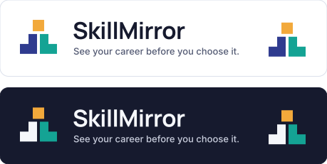

# SkillMirror — Brand Book

| | |
|---|---|
| **Version** | 1.0 (approved) |
| **Date** | 21 November 2026 |
| **Related documents** | [business.md](business.md) · [rules-and-flows.md](rules-and-flows.md) · [brand/README.md](brand/README.md) |
| **Approval status** | **Approved by the project owner on 21 November 2026:** logo (Reflected Step, variation A, "Summit"), tagline, core palette, typography, tone of voice and brand voice examples. |

### Brand at a glance

| Element | Approved choice |
|---|---|
| **Logo** | Reflected Step, variation A, "Summit" (see [section 4](#4-logo)) |
| **Tagline** | **See your career before you choose it.** |
| **Core colours** | Mirror Indigo `#2F3B8F` · Reflection Teal `#14A394` · Spark Amber `#F2A93B` |
| **Fonts** | **Manrope** (headings) · **Inter** (body text). JetBrains Mono optional, for code samples only |
| **Tone of voice** | **Honest. Encouraging. Clear.** |
| **Sounds like us** | "Explore your potential, practise real-world skills, and take your next career step with confidence." |
| **Doesn't sound like us** | ~~"Our AI guarantees you'll land your dream job."~~ |
| **Domain and Instagram** | Checked 21 Nov 2026: `skillmirror.com` and `@skillmirror` are already taken; `skillmirror.dev` appears available. See [Domain and social media checks](#domain-and-social-media-checks) |

---

## 1. Brand name and tagline

### Name
**SkillMirror**, written as one word in camel case: capital **S**, capital **M**.

| Correct | Incorrect |
|---|---|
| SkillMirror | Skillmirror · Skill Mirror · SKILLMIRROR (except in all-caps design contexts) · skill-mirror |

**Meaning:** the platform works like a mirror. It shows students an honest reflection of their current skills and of what a career really involves, so they can see clearly and take the next step.

### Tagline (approved)

> **See your career before you choose it.**

It leads with career exploration, the core of the vision. It appears in the full logo and in the homepage hero.

**Bilingual use [to be tested with native speakers]:** taglines will need translations into Macedonian and Albanian that are adapted to sound natural, not translated literally. Translations must be checked by native speakers before use.

### Domain and social media checks

**Date checked:** 21 November 2026.

**Method:**
- **Domains:** a public registration-data lookup through RDAP (rdap.org). "Registered" means the registry returned a record with a registration date. "Not found" means the registry has no record, so the name *appears* available; this is confirmed only at purchase.
- **Instagram:** opened the public profile URL `instagram.com/<handle>` without logging in.

| Name | Result | Details |
|---|---|---|
| `skillmirror.com` | ❌ **Registered** by another party | Registered since 28 May 2015 (expires 28 May 2027) |
| `skillmirror.app` | ❌ **Registered** | Since 16 Nov 2025 |
| `skillmirror.ai` | ❌ **Registered** | Since 21 Apr 2026 |
| `skillmirror.net` | ❌ **Registered** | Since 3 Aug 2026 |
| `skillmirror.org` | ❌ **Registered** | Since 3 Jun 2026 |
| `skillmirror.dev` | ✅ **Not found in the registry: appears available** | To be confirmed at a registrar |
| `skillmirror.io` | ⚠️ **Not checked** | The registry offers no RDAP service; needs a manual WHOIS or registrar search |
| `skillmirror.mk` | ⚠️ **Not checked** | No RDAP service for .mk; needs a manual search with the .mk registry (MARnet) |
| Instagram `@skillmirror` | ❌ **Taken** | An existing public profile of an unrelated company; its bio describes recruitment / applicant-tracking software, and it links to skillmirror.com |
| Instagram `@skillmirror.app`, `@skillmirror.dev`, `@getskillmirror` | ⚠️ **Inconclusive** | Instagram did not return readable page content to an automated check; must be checked manually in the app |

**What this means**
- The approved name **SkillMirror** is unchanged, but the exact `.com` domain and the exact Instagram handle are **not available**. The unrelated company using both works in recruitment software, which is a different market from career exploration. Still, the shared name could cause confusion. **No trademark search has been carried out [Open question].**
- **Proposed next step (team decision, not yet done):** register `skillmirror.dev` (about US$12/year) and choose an available Instagram handle such as `@skillmirror.dev` after checking it manually. Record the final choices here with the date.

---

## 2. Brand positioning

### Positioning statement
> **For** Computer Science and IT university students **who** are unsure which career suits them and how ready they are, **SkillMirror is** an AI-powered career exploration and simulation platform **that** lets them try realistic professional tasks, see their skill gaps against clear criteria, and leave with three concrete next steps. **Unlike** coding-quiz sites, generic courses or employer-run recruiting programmes, **SkillMirror** reflects the student's own potential honestly and keeps the student in control of their results.

### What SkillMirror is / is not

| SkillMirror **is** | SkillMirror **is not** |
|---|---|
| A career exploration and readiness tool | A recruitment agency |
| A realistic job simulator | A student–employer marketplace or job board |
| An honest, rubric-based feedback coach | A freelance platform |
| Student-owned and student-controlled | A certification body or hiring guarantee |
| A guide to the next three steps | An endless course catalogue |

### Brand promise
**Honest reflection, real practice, clear next steps.**

### Core values

| Value | What it means in practice |
|---|---|
| **Honesty** | Feedback is direct and based on evidence, and we are open about what AI can and cannot judge. We never inflate scores to make students feel good. |
| **Realism** | Simulations look like real work, including ambiguity, messy code and communication. |
| **Clarity** | One summary and three next steps. No jargon without an explanation. |
| **Respect** | Students own their data. Feedback is kind and never belittling. |
| **Growth** | A gap is a starting point, not a verdict. |

---

## 3. Brand personality

**Tone of voice in three words: Honest. Encouraging. Clear.**

If SkillMirror were a person, it would be **a supportive senior colleague in their first week as your mentor**: experienced, straightforward, encouraging, and respectful of your time.

| We are… | …but not |
|---|---|
| Honest | Harsh or discouraging |
| Encouraging | Over-hyped or full of empty praise |
| Professional | Corporate or stiff |
| Clear | Simplistic or patronising |
| Curious | Gimmicky |
| Modern and tech-literate | Trendy for its own sake |

---

## 4. Logo

**Approved logo: Reflected Step, variation A, "Summit"** (approved by the project owner on 21 November 2026).

| On light backgrounds | On dark backgrounds |
|---|---|
|  |  |
|  |  |

The dark-background files have a transparent background and light-coloured artwork. The panel image in [Brand at a glance](#brand-at-a-glance) ([`skillmirror-logo-preview.svg`](brand/logo/skillmirror-logo-preview.svg)) shows them on the Ink background.

### Concept
An **indigo staircase** and its **teal mirrored staircase** rise towards each other on either side of a clear vertical **mirror line**. Above them floats an **amber block**: the next career step, shared by both sides. Together they say what SkillMirror does: an honest reflection of where you are, and a clear next step.

### Construction (64 × 64 grid)
- Each staircase has two steps of 12 units, and the outline rises from the outer edge to the centre.
- The mirror line is a 4-unit gap between the two staircases.
- The amber block is 16 × 16 units, centred over the mirror line, with the same 4-unit gap below it.
- Flat colour only: no gradients, shadows or outlines.

### Colour versions

| Element | On light backgrounds | On dark backgrounds |
|---|---|---|
| Left staircase | Mirror Indigo `#2F3B8F` | Mist `#F5F7FB` (Indigo loses contrast on dark) |
| Right staircase | Reflection Teal `#14A394` | Reflection Teal `#14A394` |
| Next-step block | Spark Amber `#F2A93B` | Spark Amber `#F2A93B` |
| Wordmark "SkillMirror" (Manrope 700) | Ink `#161A2E` | Mist `#F5F7FB` |
| Tagline (Inter 500) | Slate `#535A73` | `#C9CEDD` |

In the SVG files the wordmark and tagline are converted to outlines, so the logo renders the same without the fonts installed.

### Usage rules
- **Full logo** (icon + wordmark + tagline): website header, presentations, documents and partner material.
- **Icon on its own:** favicon, app icon, social-media avatar. It stays legible at 16 × 16 px.
- **Clear space:** keep at least the width of the amber block (a quarter of the icon's height) free on all sides.
- **Minimum size:** icon 16 px; full logo 240 px wide, so the tagline stays readable.
- **Don't:** recolour, rotate, stretch, add effects, rearrange the elements, or place the light-background version on a dark background (or the other way round).
- The previous, rejected logo must not be used, adapted or referenced.

---

## 5. Colour palette

> **Status: approved.** Contrast ratios below were calculated with the WCAG 2.x relative-luminance formula. Target: **WCAG 2.1 AA** (at least 4.5:1 for normal text, at least 3:1 for large text and UI components).

### Core palette (the three brand colours)

| Role | Name | HEX | Contrast on White `#FFFFFF` | Recommended use |
|---|---|---|---|---|
| Primary | **Mirror Indigo** | `#2F3B8F` | 9.80 : 1 ✅ | Logo, primary buttons, links, headings, key UI |
| Secondary | **Reflection Teal** | `#14A394` | 3.14 : 1 ⚠️ large text / graphics only | Logo, illustrations, progress bars, highlights, icons |
| Accent | **Spark Amber** | `#F2A93B` | 2.00 : 1 ❌ never for text on white | Logo, small accents, badges, "next step" highlights. On dark backgrounds, or with Ink text on top (8.61 : 1 ✅) |

### Supporting colours

These support the core palette in the product UI. They are not brand colours in their own right.

| Name | HEX | Contrast on White | Use |
|---|---|---|---|
| **Deep Indigo** | `#1F2766` | 13.63 : 1 ✅ | Hover/pressed states, dark sections |
| **Deep Teal** (text-safe) | `#0B7368` | 5.73 : 1 ✅ | Teal-coloured text and small UI elements |

### Neutrals

| Name | HEX | Contrast on White | Use |
|---|---|---|---|
| **Ink** | `#161A2E` | 17.19 : 1 ✅ | Body text, primary text |
| **Slate** | `#535A73` | 6.82 : 1 ✅ | Secondary text, captions |
| **Line** | `#DCE1EC` | n/a (decorative) | Borders, dividers |
| **Mist** | `#F5F7FB` | n/a (background) | Page and section backgrounds |
| **White** | `#FFFFFF` | n/a | Cards, surfaces |

### Feedback (semantic) colours

Used in rubric feedback and the skill-gap analysis. **Colour must never be the only signal.** Always pair it with an icon and a text label (for example "Meets expectations").

| Meaning | Name | HEX | Contrast on White |
|---|---|---|---|
| Strength / meets expectations | **Success Green** | `#1C7C4E` | 5.19 : 1 ✅ |
| Developing / partially meets | **Warning Ochre** | `#9A5B0A` | 5.42 : 1 ✅ |
| Gap / not yet demonstrated | **Error Red** | `#B93A32` | 5.65 : 1 ✅ |

**Tone note:** a skill gap is not a failure. In the gap analysis, prefer Warning Ochre and neutral framing. Reserve Error Red for problems such as a failed upload or broken submission, not for judging a student's skill level.

### Suggested proportions
About 60% neutrals (White, Mist), 25% Ink and Slate text, 10% Mirror Indigo, 5% Teal and Amber accents.

### Dark mode
Background `#161A2E` (Ink), surface `#1F2766` (Deep Indigo), text `#F5F7FB` (Mist, 16.03 : 1 on Ink ✅), with Teal `#14A394` (5.48 : 1 on Ink ✅) and Amber `#F2A93B` (8.61 : 1 on Ink ✅) as accents. Wherever Mirror Indigo would lose contrast on a dark background (including the logo), use Mist instead.

---

## 6. Typography

**Brand fonts: Manrope and Inter.** Both are free on Google Fonts and support **Latin with Albanian characters (ë, ç)** and **Macedonian Cyrillic (ѓ, ќ, ѕ, љ, њ, џ)**. Check these glyphs in the product's rendered pages during development.

| Use | Typeface | Weights | Why |
|---|---|---|---|
| **Headings, display & wordmark** | **Manrope** | 600, 700, 800 | Modern geometric sans; confident but friendly; Cyrillic support |
| **Body & UI** | **Inter** | 400, 500, 600 | Highly legible on screens; extensive language support |

**Optional, for code samples only:** **JetBrains Mono** (400, 600) for code in simulation briefs and feedback snippets. It is not a brand font and is never used for headings or body text.

**Fallback stack:** `Inter, system-ui, -apple-system, "Segoe UI", Roboto, Arial, sans-serif`

### Type scale (web, base 16 px)

| Style | Font | Size / line height | Weight |
|---|---|---|---|
| Display | Manrope | 40 / 48 px | 800 |
| H1 | Manrope | 32 / 40 px | 700 |
| H2 | Manrope | 24 / 32 px | 700 |
| H3 | Manrope | 20 / 28 px | 600 |
| Body | Inter | 16 / 24 px | 400 |
| Small / caption | Inter | 14 / 20 px | 400 |
| Code | JetBrains Mono | 14 / 22 px | 400 |

Body text must never be smaller than 14 px. Lines should be kept to about 60–80 characters.

---

## 7. Brand voice

**Tone of voice: Honest. Encouraging. Clear.**

| | Example sentence |
|---|---|
| ✅ **Sounds like SkillMirror** | "Explore your potential, practise real-world skills, and take your next career step with confidence." |
| ❌ **Does not sound like SkillMirror** | "Our AI guarantees you'll land your dream job." It promises an outcome nobody can guarantee, presents AI as infallible, and turns SkillMirror into a recruitment promise, which goes against all three tone words. |

### Voice principles

| Principle | Do | Don't |
|---|---|---|
| **Honest, not harsh** | "Your layout works on desktop but breaks below 375 px. Here's where to look." | "Your layout is bad." |
| **Specific, not vague** | "Add visible focus styles to the filter buttons (rubric criterion A-2)." | "Improve accessibility." |
| **Encouraging, not hyped** | "You've shown solid debugging skills. That's a core junior strength." | "Amazing!!! You're a rockstar developer! 🚀🚀" |
| **Clear, not jargon-heavy** | "A *pull request description* explains what you changed and why." | Unexplained acronyms on first use |
| **Transparent about AI** | "This feedback was generated by AI using the published rubric. It's an estimate, not a grade." | Presenting AI feedback as a definitive expert verdict |
| **Respectful of choice** | "Frontend may not be your path, and that's useful to know too." | Pressuring students to continue or upgrade |

### Language and localisation
- Product languages (target): **English, Macedonian, Albanian**. Technical terms (for example "pull request", "component") may stay in English where that is normal practice in local workplaces, with a short explanation. **[Assumption: check with local developers]**
- Address the student directly as "you" and keep sentences short. In Macedonian and Albanian, the choice between formal and informal address must be decided with native speakers. **[Open question]**

### Words we use / avoid

| Prefer | Avoid |
|---|---|
| explore, try, reflect, practise, gap, next step, readiness, evidence | guaranteed job, hire-ready, certified, fail, beat the competition, hack your career |
| "AI-assisted feedback" | "AI-certified", "AI-verified" |
| "career readiness summary" | "certificate", "diploma", "official score" |

---

## 8. Examples of brand messaging

> These are examples to show tone. They contain **no** real statistics, testimonials or user quotes, and none should be added until real data exists.

**Homepage hero**
> **See your career before you choose it.**
> Try realistic Junior Frontend Developer tasks, get honest feedback against clear criteria, and leave with three concrete next steps.
> [Start your career snapshot]

**Simulation introduction (S2 — "Fix It in Production")**
> It's Tuesday morning. A user has reported that the sign-up form rejects valid email addresses, and keyboard users can't submit it at all. Your team lead has assigned you the ticket. Reproduce the bug, fix it with the smallest safe change, and write a short note explaining what happened.
> *Suggested time: 60–90 minutes. There's no timer. Work the way you would at a real job.*

**Feedback message (rubric-based)**
> **Accessibility — Developing**
> Your fix works with a mouse, but the submit button still can't be reached with the Tab key. Rubric criterion A-2 expects interactive elements to be keyboard-operable.
> *Try this:* replace the clickable `
` with a `<button>` element.
> *AI-assisted feedback based on the SkillMirror rubric. Treat it as a guide, not a grade.*

**Skill-gap summary line**
> You rated yourself "confident" in responsive layout, and your simulations showed strong mobile layouts. Your biggest gap is handling loading and error states, which came up in S3.

**Next-step card**
> **Next step 1 of 3 — Handle async UI states**
> Build a small page that fetches data and shows loading, empty and error states. *About 3–4 hours.* You're done when each state can be triggered and looks intentional.

**Social media post (campus pilot recruitment)**
> Studying CS or IT and wondering if frontend is for you? We're looking for students to try three realistic Junior Frontend Developer tasks and give us honest feedback. Free, and your results are yours. [link]

**Partner outreach (career centre, opening line)**
> We're building SkillMirror, a career exploration tool that lets CS/IT students try realistic frontend developer tasks and get rubric-based feedback. We'd like to run a free pilot workshop with your students and share what we learn.

**What we would never write**
> ~~"Get hired by top companies with SkillMirror!"~~ (recruitment promise; contradicts positioning)
> ~~"9 out of 10 students land a job!"~~ (invented statistic)
> ~~"Your SkillMirror certificate proves you're job-ready."~~ (false certification claim)

---

## 9. Brand assets

All approved brand assets are stored in [`docs/brand/`](brand/). The full list is in [`docs/brand/README.md`](brand/README.md).

| File | Use |
|---|---|
| [`brand/logo/skillmirror-logo-light.svg`](brand/logo/skillmirror-logo-light.svg) | Full logo (icon, wordmark, tagline) for light backgrounds |
| [`brand/logo/skillmirror-logo-dark.svg`](brand/logo/skillmirror-logo-dark.svg) | Full logo for dark backgrounds |
| [`brand/logo/skillmirror-icon-light.svg`](brand/logo/skillmirror-icon-light.svg) | Icon on its own for light backgrounds |
| [`brand/logo/skillmirror-icon-dark.svg`](brand/logo/skillmirror-icon-dark.svg) | Icon on its own for dark backgrounds |
| [`brand/logo/skillmirror-logo-preview.svg`](brand/logo/skillmirror-logo-preview.svg) | Presentation sheet showing both versions on light and dark panels (for documents, not production use) |

## 10. Approval checklist

| Item | Status |
|---|---|
| Tagline: "See your career before you choose it." | ✅ Approved (21 Nov 2026) |
| Logo: Reflected Step, variation A, "Summit" | ✅ Approved (21 Nov 2026) |
| Final logo artwork (SVG, light and dark) | ✅ Delivered in `docs/brand/logo/` |
| Core palette: Indigo, Teal, Amber | ✅ Approved (21 Nov 2026) |
| Typography: Manrope + Inter (JetBrains Mono optional for code) | ✅ Approved (21 Nov 2026) |
| Tone of voice: Honest, Encouraging, Clear | ✅ Approved (21 Nov 2026) |
| Brand voice examples (sounds like us / doesn't) | ✅ Approved (21 Nov 2026) |
| Domain and Instagram availability check | ✅ Checked 21 Nov 2026 (see section 1). `.com` and `@skillmirror` taken; `.dev` appears available |
| Register a domain and Instagram handle | ⏳ Not done; requires a team decision and a manual handle check |
| Macedonian & Albanian tagline translations | ⏳ Not started; native-speaker review needed |
