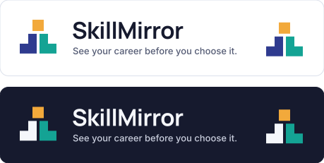

# SkillMirror — Brand Assets

This directory holds the **approved** SkillMirror brand assets. The rules for using them are in [`../brand-book.md`](../brand-book.md).

## Current status

**The visual identity is approved** (project owner, 21 November 2026).

- **Logo:** Reflected Step, variation A, "Summit"
- **Tagline:** See your career before you choose it.
- **Core colours:** Mirror Indigo `#2F3B8F` · Reflection Teal `#14A394` · Spark Amber `#F2A93B`
- **Fonts:** Manrope (headings) · Inter (body text). JetBrains Mono optional, for code samples only.

The previous, rejected logo must not be stored here, reused or used as a base for new work.

## Final assets

| File | Description | Background |
|---|---|---|
| [`logo/skillmirror-logo-light.svg`](logo/skillmirror-logo-light.svg) | Full logo: icon, wordmark and tagline | Light |
| [`logo/skillmirror-logo-dark.svg`](logo/skillmirror-logo-dark.svg) | Full logo: icon, wordmark and tagline | Dark |
| [`logo/skillmirror-icon-light.svg`](logo/skillmirror-icon-light.svg) | Icon on its own (favicon, app icon, avatar) | Light |
| [`logo/skillmirror-icon-dark.svg`](logo/skillmirror-icon-dark.svg) | Icon on its own (favicon, app icon, avatar) | Dark |
| [`logo/skillmirror-logo-preview.svg`](logo/skillmirror-logo-preview.svg) | Presentation sheet: both versions on white and Ink panels | Included |

All logo files are vector SVGs. The wordmark and tagline are converted to outlines, so no fonts need to be installed. The dark versions have a transparent background and are meant for backgrounds such as Ink `#161A2E`.



## Structure

```
brand/
  README.md
  logo/          # Approved logo SVGs (light, dark, icon, preview)
```

## Approval log

| Date | Item | Decision | Approved by |
|---|---|---|---|
| 21 Nov 2026 | Logo: Reflected Step, variation A, "Summit" | Approved | Project owner |
| 21 Nov 2026 | Tagline, core palette, typography | Approved | Project owner |
| 21 Nov 2026 | Tone of voice and brand voice examples | Approved | Project owner |
