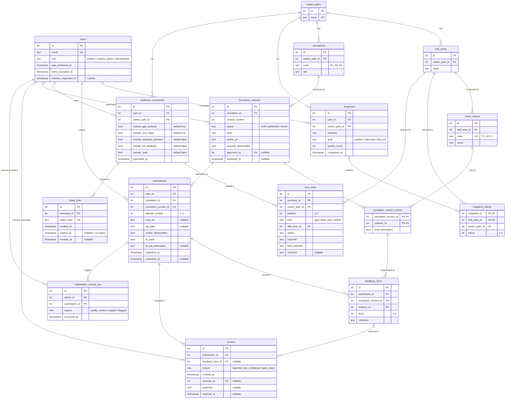

# SkillMirror — Data Model

| | |
|---|---|
| **Version** | 1.0 |
| **Date** | 22 November 2026 |
| **Related documents** | [rules-and-flows.md](rules-and-flows.md) · [business.md](business.md) · [stack.md](stack.md) |
| **Scope** | Version 1 (MVP) database schema. Created by migration `backend/drizzle/0000_initial_schema.sql`. |
| **Source of truth** | The Drizzle schema in `backend/src/db/schema/`. This document explains it; if they ever disagree, the schema wins and this document must be updated. |

Every table and field below comes from a rule or flow in [rules-and-flows.md](rules-and-flows.md). Nothing is stored "just in case".

---

## 1. Database diagram

---

## 2. Tables and the rules they come from

### Users and content

| Table | Purpose | Key constraints | Source |
|---|---|---|---|
| **users** | Registered accounts: students and internal staff. Visitors and summary viewers have no account. | `email` unique. `role` limited to student / content_author / administrator. Age confirmation and terms acceptance are required. | §2 roles, BR-2, BR-12, Journey 1 |
| **career_paths** | Target roles. v1 has one: Junior Frontend Developer. | `name` unique. | §1 |
| **skill_areas** | The skill profile of a career path (8 areas in v1). | Unique per path. | §6 |
| **rubric_criteria** | Criteria such as F-1 or A-2. Each maps to exactly one skill area. | `code` unique. | §5, §6 |
| **simulations** | S1, S2 and S3. | Unique code per path. | §7 |
| **simulation_versions** | Versioned content of a simulation: brief, starter files, required deliverables. | Unique version number per simulation. Status limited to draft / published / retired. **At most one published version per simulation** (partial unique index). A published version must have `published_at`. | BR-13 |
| **simulation_version_criteria** | The published rubric of one version, with level descriptors per criterion. | Composite primary key (version, criterion). | BR-3, §1 |

### Student journey

| Table | Purpose | Key constraints | Source |
|---|---|---|---|
| **snapshots** | The career snapshot. | One per student per career path. Goal limited to explore / internship / first_job. | Journey 1, BR-1 |
| **snapshot_ratings** | Self-rating (1–4) for each skill area. | Rating between 1 and 4. The skill area must belong to the snapshot's career path (enforced, see §3). | Journey 1, §6 |
| **submissions** | One evaluated attempt at a simulation. Uploads rejected by automatic validation are never stored, so they never use an attempt. | **Attempt number 1–3, unique per student per simulation** (the limit counts across versions). Exactly one of `repo_url` / `zip_path`. A description is required when `ai_used` is true. The version must belong to the stated simulation. | Journey 2, BR-5, BR-11, BR-13 |
| **feedback_items** | Level (0–3) and comment for one rubric criterion of one submission. | One per criterion per submission. **The criterion must be in the rubric of the exact version used** (enforced, see §3). There is no total-score column anywhere in the database. | BR-3, BR-4 |
| **reviews** | Human review queue: disputed feedback, low-confidence results and random spot checks. | Reason limited to reported / low_confidence / spot_check. A `reported` review must name the feedback item. The item must belong to the same submission. | BR-6 |
| **submission_access_log** | Records every time an administrator opens a student's submission. | Reason limited to quality_review / support / flagged. | §2 permission matrix ("logged") |
| **readiness_summaries** | The student's readiness summary and the sections they choose to include. | One per student per career path. **Code, snapshot answers and full feedback default to "not included"**. | BR-7, BR-9 |
| **next_steps** | The three recommended next steps. | Position 1–3, unique per summary. Kind limited to gap / blind_spot / stretch. Outcome and time estimate are required. The skill area must belong to the summary's career path. | BR-8 |
| **share_links** | Revocable, optionally expiring links to a summary. | Only a **hash** of the token is stored, so a copy of the database file cannot open shared summaries. `expires_at` is empty (no expiry) or later than `created_at`. | BR-9, BR-12 |

---

## 3. Integrity rules enforced by the database

SQLite only enforces foreign keys when each connection turns them on. `backend/src/db/client.ts` runs `PRAGMA foreign_keys = ON` for every connection, and `/health` reports an error if it is off.

| Rule | How it is enforced |
|---|---|
| Feedback only uses criteria from the rubric of the **exact version** the submission used (BR-3, BR-13) | `feedback_items` stores `simulation_version_id`. Composite foreign key (`submission_id`, `simulation_version_id`) → `submissions(id, simulation_version_id)`, and composite foreign key (`simulation_version_id`, `criterion_id`) → `simulation_version_criteria`. |
| A submission's version belongs to its simulation | Composite foreign key (`simulation_version_id`, `simulation_id`) → `simulation_versions(id, simulation_id)`. |
| At most 3 evaluated attempts per simulation (BR-5) | `CHECK (attempt_number BETWEEN 1 AND 3)` and `UNIQUE (user_id, simulation_id, attempt_number)`. |
| A rating only uses skill areas of the snapshot's career path (§6) | `snapshot_ratings` stores `career_path_id`. Composite foreign keys to `snapshots(id, career_path_id)` and `skill_areas(id, career_path_id)`. |
| A next step only targets skill areas of the summary's career path (BR-8) | `next_steps` stores `career_path_id`. Composite foreign keys to `readiness_summaries(id, career_path_id)` and `skill_areas(id, career_path_id)`. |
| A disputed feedback item belongs to the reviewed submission (BR-6) | Composite foreign key (`feedback_item_id`, `submission_id`) → `feedback_items(id, submission_id)`. |
| Only one published version per simulation (BR-13) | Partial unique index on `simulation_id` where `status = 'published'`. |
| Deleting an account deletes all of the student's data (BR-12) | Every student-owned table cascades from `users` (`ON DELETE CASCADE`). |
| Never more than three next steps (BR-8) | `CHECK (position BETWEEN 1 AND 3)` and `UNIQUE (summary_id, position)`. |

Each composite foreign key points at columns that have their own unique key (for example `UNIQUE (id, simulation_version_id)` on `submissions`). SQLite requires this, and rejects inserts with "foreign key mismatch" without it.

---

## 4. Rules enforced in application code

The database cannot check these on its own, because they depend on other rows existing. Each must be enforced by the feature that writes the data, when that feature is built.

| Rule | Required behaviour |
|---|---|
| **Exactly three next steps (BR-8)** | Next steps 1, 2 and 3 **must be inserted together in one transaction**: all three are saved, or none are. A readiness summary is **not complete**, and must not be shown or shared, **unless all three exist**. |
| **Complete snapshot (Journey 1)** | The snapshot and a rating for every skill area of the path are saved in one transaction. |
| **Snapshot first (BR-1)** | A submission can only be created when the student has a completed snapshot for that career path. |
| **Summary prerequisites (BR-7)** | A summary is generated only when the snapshot exists and all three simulations have at least one evaluated submission. |
| **Latest attempt counts (BR-5)** | The gap analysis uses the evaluated submission with the highest `attempt_number` for each simulation. Earlier attempts stay visible. |
| **Active share link (BR-9, BR-12)** | A link works only if `revoked_at` is empty, `expires_at` is empty or in the future, and the owner has no `deletion_requested_at`. A deletion request also sets `revoked_at` on all of the student's links immediately. |
| **Expiry choices (BR-9)** | The student can choose 7, 30 or 90 days, or no expiry. |
| **Published versions are not edited (BR-13)** | Changes create a new version. Publishing it retires the previous one in the same transaction. |
| **Students submit; staff test (§2)** | Only students make real submissions. Content authors and administrators use test mode. |

---

## 5. Calculated, not stored

| Value | Calculated from |
|---|---|
| Skill-gap analysis: strength, gap, blind spot, not assessed (§6) | Snapshot ratings and the feedback levels of the latest evaluated attempts |
| Attempts remaining (BR-5) | Count of the student's submissions for the simulation |
| Anonymised usage statistics (§2) | Aggregate queries |

Rubric levels (0–3), roles, goals and statuses are fixed lists, enforced with `CHECK` constraints instead of lookup tables.

---

## 6. Deliberately not stored

| Not stored | Why |
|---|---|
| Student names or other profile details | No rule needs them (data minimisation) |
| Login credentials or sessions | The login method is not decided yet. Added with the authentication feature |
| Total scores or "employability" numbers | Forbidden by BR-4 |
| Uploads rejected by automatic validation | They do not use an attempt (BR-5) |
| Plain share-link tokens | Only a hash is stored (BR-9) |
